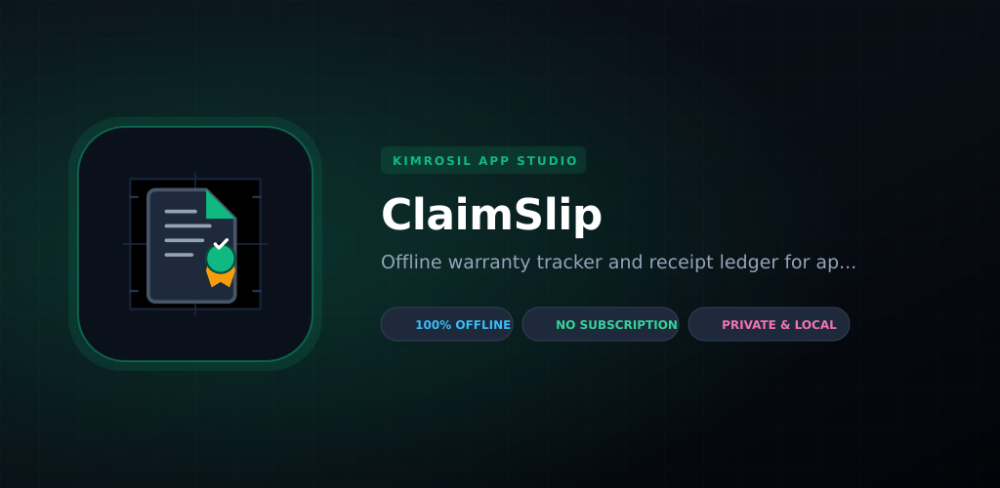

# FlareGage

<p align="center">
  
</p>

<p align="center">
  <a href="https://android.com"></a>
  <a href="https://github.com/eliakimrosil/kimrosil-app-studio"></a>
  <a href="https://github.com/eliakimrosil/kimrosil-app-studio/releases/tag/v1.0.1-flare-gage"></a>
  <a href="https://apps.kimrosil.com/flare-gage/"></a>
  <a href="https://apps.kimrosil.com/flare-gage/"></a>
</p>

<p align="center">
  <b><a href="https://apps.kimrosil.com/flare-gage/">🌐 Web App Store</a></b> •
  <b><a href="https://github.com/eliakimrosil/kimrosil-app-studio/releases/download/v1.0.1-flare-gage/flare-gage.apk">📦 Direct APK Download</a></b> •
  <b><a href="https://apps.kimrosil.com/flare-gage/privacy.html">🔒 Privacy Policy</a></b> •
  <b><a href="https://github.com/eliakimrosil/kimrosil-app-studio">🏢 Studio Catalog</a></b>
</p>

---

## ⚡ Overview

**FlareGage** is a 100% offline-first engineering micro-utility designed for HVAC technicians, automotive brake specialists, and mobile hydraulic fabricators to verify tubing flare dimensions, stickout depth, and seating torque specifications in real time.

Fabricating brake lines, refrigeration loops, and mini-split linesets frequently results in catastrophic leaks or split flares when flare dimensions deviate by as little as 0.5 mm:
- **Undersized Flares**: Pull cleanly through the flare nut under operating pressures exceeding 450 PSI (R410A) or 2,500 PSI (hydraulic brake circuits).
- **Oversized Flares**: Gall-lock against fitting threads, crack the flare cone lip, and leak upon pressure cycling.

**FlareGage** eliminates guesswork by providing instant caliper-guided verification, dynamic 2D cross-section telemetry, torque benchmarks, and an offline inspection signoff ledger—with zero cloud dependencies, zero ads, and zero account walls.

---

## 🛠️ Key Capabilities

### 1. Four International Flaring Standards
- **45° SAE Single Flare**: Standard in residential mini-splits, heat pumps, refrigeration coils, and brass flare fittings.
- **45° SAE Double / Inverted (SAE J533)**: Automotive standard for hydraulic brake circuits and high-pressure fuel lines. Features an inverted fold that doubles the wall thickness to resist hydraulic pulsation fatigue.
- **37° AN / JIC (MIL-F-5509 / SAE J514)**: High-pressure motorsport, aviation, and aerospace hydraulic lines. Steeper 37° cone angle provides superior sealing contact area.
- **DIN / ISO Bubble Flare (DIN 74234)**: European automotive brake lines (VW, BMW, Audi, Mercedes) mating with flat-bottom threaded port seats.

### 2. Complete Workshop Tubing Coverage
Supports all seven standard workshop tubing outer diameters:
- `3/16"` (4.76 mm) — Primary automotive brake line
- `1/4"` (6.35 mm) — Mini-split liquid line & fuel line
- `5/16"` (7.94 mm) — Fuel line & transmission cooler
- `3/8"` (9.53 mm) — Mini-split suction line & gas line
- `1/2"` (12.70 mm) — Residential lineset & heat pumps
- `5/8"` (15.88 mm) — Commercial refrigeration & VRF systems
- `3/4"` (19.05 mm) — Heavy commercial refrigeration linesets

### 3. Metallurgy Profiles & Heat Treat Warnings
- **Soft Copper**: Lineset standard. Deburring instructions and POE/mineral oil cone lubrication guidelines.
- **Hard Drawn Copper**: Automatic metallurgy warning! Alerts technician to anneal tubing with a torch to dull cherry red and quench prior to flaring to prevent rim splitting.
- **CuNi (Copper-Nickel / Cunifer)**: Corrosion-proof automotive brake line alloy.
- **Steel Bundy Tube**: Double-flare adapter steps and clamping depth requirements.
- **304 Stainless Steel**: Extreme work-hardening alloy torque benchmarks and anti-seize paste requirements.
- **Aluminum**: Soft alloy over-torque defense preventing flare cone crushing.

### 4. Interactive Engineering Cross-Section Canvas (`FlareProfileView`)
- Real-time 2D Canvas rendering the exact geometric profile: cylindrical tube wall, cone angle (45°, 37°, or ISO bubble bulb), and nominal tolerance boundaries.
- Dynamic caliper indicator: measures measured flare head OD against nominal brackets, dynamically color-coding green (safe in-tolerance), red (undersized/oversized hazard), or amber (marginal fit).

### 5. Field Caliper Verification Mode
- Enter measured flare outer diameter from any dial or vernier caliper in millimeters or decimal inches.
- Instant pass/fail determination, deviation calculation ($\Delta \text{ mm}$), and actionable corrective instructions.

### 6. Local Inspection Signoff Log (`DatabaseHelper`)
- Store verified lines per job work order or vehicle VIN directly in local SQLite storage.
- Review field inspection history, copy signoff entries, or share formatted reports via standard Android share sheet.

### 7. Android Quick Settings Tile (`FlareGageTileService`)
- 1-tap launcher directly from the notification shade for oily-glove field access without leaving camera or inspection apps.

### 8. Day / Night / Auto Theming
- Working theme engine adapting dynamically between Auto, Forced Light, and Forced Dark modes.
- High-contrast visual tokens tailored for bright outdoor sunlight and dark vehicle undercarriages alike.

---

## 📐 Architecture & Technology Stack

- **Platform**: Pure Android Native Framework (API Level 26–34)
- **Language**: Java 8 (Pure Native, zero Compose or Kotlin runtime bloat)
- **Layouts**: Responsive XML (`ScrollView`, tabular cards, 10–12dp tactile rounded shapes)
- **Graphics Engine**: Custom hardware-accelerated `android.graphics.Canvas` and `android.graphics.Paint`
- **Local Persistence**: `SQLiteOpenHelper` (`DatabaseHelper.java`) and `SharedPreferences`
- **Network Permissions**: **None** (`100% Offline`)
- **Binary Size**: ~97 KB

---

## 🔨 Building from Source

This project compiles natively using Termux or standard Android Gradle:

```bash
# Clone the repository branch
git clone -b app/flare-gage https://github.com/eliakimrosil/kimrosil-app-studio.git flare-gage
cd flare-gage

# Build Debug APK
gradle assembleDebug

# Build Signed Release APK
gradle assembleRelease

# Build Google Play Production Bundle (AAB)
gradle bundleRelease

# Build All Variants
gradle buildAll
```

Compiled outputs will be located in `build/outputs/`.

---

## 📄 License & Attribution

Distributed as **Proprietary Freeware** under the KimRosil App Studio EULA. Free for personal, trade, and internal commercial use.

Copyright &copy; 2026 **[Eliakim Rosil](https://github.com/eliakimrosil)**. All Rights Reserved.
